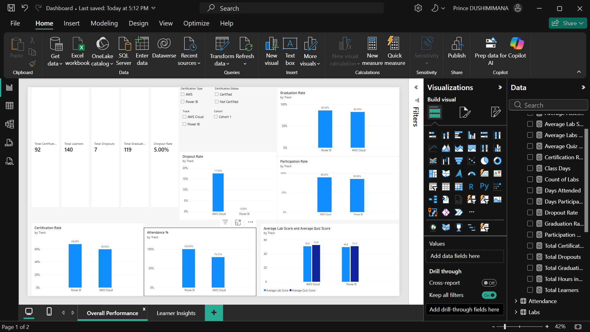
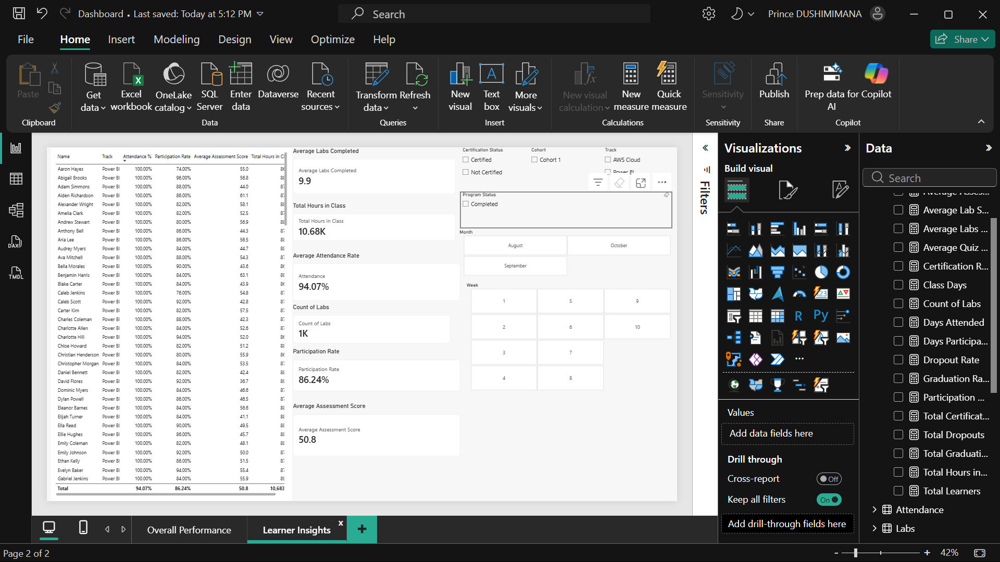
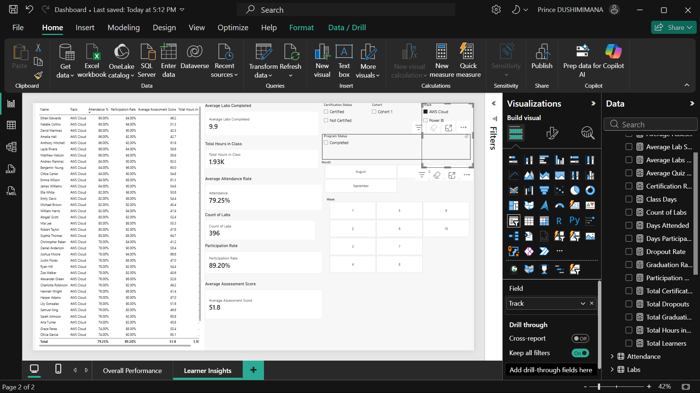
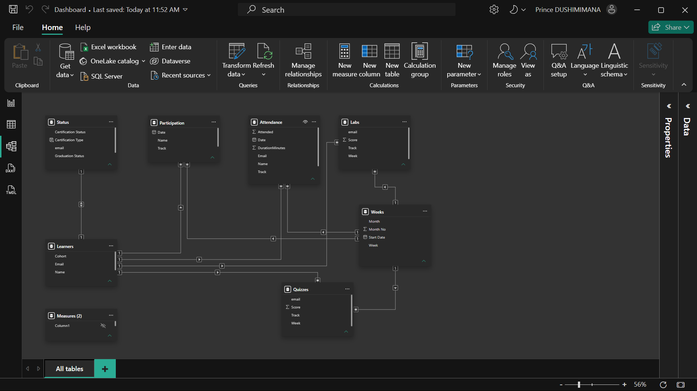

# Dare Careers: Student Progress and Performance Dashboard

A two-page Power BI dashboard that tracks the progress and performance of Dare Careers learners across the **Power BI** and **AWS Cloud** training tracks over a 10-week program (5 Aug - 11 Oct 2024).

## What the dashboard answers

- How many learners enrolled, graduated, got certified or dropped out?
- How well do learners attend, take part and score in quizzes and labs?
- Which individual learners are at risk, and how do things change week by week?

## Pages

### Page 1: Overall Performance Metrics

For program stakeholders.

- **Cards:** Total Learners, Total Certifications, Total Dropouts, Total Graduations.
- **Bar charts:** Graduation, Certification and Dropout Rates; Average Attendance; Average Participation; Average Assessment Scores (labs and quizzes).
- **Slicers:** Cohort, Track, Certification Type (AWS / Power BI), Learner Status (Certified / Not Certified).



### Page 2: Detailed Learner Insights

For trainers and program managers.

- **Learner table:** each learner's track, attendance, participation and assessment score.
- **Cards:** Count of Labs, Average Labs Completed, Total Hours in Class, Average Attendance Rate, Average Participation Rate, Average Assessment Score.
- **Slicers:** Cohort, Track, Month, Week, Learner Status, Program Status (Ongoing / Completed).



Slicers filter every visual on the page, for example the AWS Cloud track only:



## Key rule: what counts as "Attended"

A learner is marked **Attended** for a day only if they spent **more than 30 minutes** in that day's Zoom session. This applies to every attendance calculation.

## Data

| Source | Format | Notes |
|---|---|---|
| Zoom attendance | 50 daily CSV files per track (Weeks 1-10) | Power BI durations are `h:mm:ss`; AWS Cloud durations are plain minutes. Both are converted to minutes. |
| Labs and quizzes | One Excel workbook per track, weeks as columns | Unpivoted into one row per learner per week. |
| Participation | One Excel file per track, one row per day with a comma-separated list of names | Split into one row per learner per day. |
| Learner status | One Excel file per track | Graduation and certification status per learner. |

The raw data files are not included in this repository.

## Data preparation (Power Query)

- Combined the daily attendance files for each track, took the date from each file name, converted durations to minutes, and added a `Track` column and an `Attended` flag (1 if more than 30 minutes, otherwise 0).
- Unpivoted the weekly lab and quiz scores and turned "Week 1" into the number 1.
- Split each day's participant list into one row per learner.
- Appended the Power BI and AWS Cloud versions of each table into one table (`Attendance`, `Labs`, `Quizzes`, `Participation`, `Status`).
- Built a `Learners` table (one row per learner) to connect everything, with a `Cohort` column (`Cohort 1`) so more cohorts can be added later, and a `Program Status` column.
- Added a `Certification Type` column to `Status` (AWS or Power BI, following the learner's track).

## Data model

`Learners` and `Weeks` are the two dimension tables. The `Weeks` table (weeks 1-10 with their month) lets the Week and Month slicers filter attendance, participation, labs and quizzes together.



The full list of relationships and every DAX measure is in [docs/dax_measures.md](docs/dax_measures.md).

## Assumptions

- The dataset is a **single cohort** (`Cohort 1`) with two tracks, Power BI and AWS Cloud. The model has a `Cohort` column and Cohort slicers so more cohorts can be added later.
- A **dropout** meets all three conditions at once: Non Graduate, Not Certified, and incomplete attendance. **Incomplete attendance** means attendance below 100% over the whole program (at least one class day missed under the 30-minute rule). This gives 7 dropouts, all in AWS Cloud.
- **Certification Type** is AWS or Power BI, following the learner's track.
- A **lab counts as completed** when its score is above 0.
- **Program Status** is derived, because the data has no such column: a learner is `Completed` once they have attendance through the last class day (11 Oct 2024), otherwise `Ongoing`. All 140 learners show as Completed.

## Known limitations

- With this data, the "incomplete attendance" condition of the dropout rule separates AWS Cloud from Power BI: every Power BI learner attended all 50 days, and every AWS Cloud learner missed at least one. The rule still follows the supervisor's three conditions and gives 7 dropouts.
- The `Weeks` table starts on 5 Aug 2024. A future cohort with different dates would need its own start date (for example a start-date column on `Learners`).
- Participation records contain names only, so `Participation` joins to `Learners` by name. This works because no learner names repeat.

## Headline numbers (all learners)

| Metric | Value |
|---|---|
| Total learners | 140 (100 Power BI, 40 AWS Cloud) |
| Graduations | 119 (85.0%) |
| Certifications | 92 (65.7%) |
| Dropouts | 7 (5.0%) |
| Attendance | 94.1% |
| Participation | 86.2% |
| Average assessment score | 50.8 |

## How to open

Open `dashboard/Dashboard.pbix` in Power BI Desktop. The data sources point to local folders, so to refresh the data, update the folder paths in **Transform data → Data source settings**.

## Repository structure

```
├── dashboard/        Power BI file
├── docs/             DAX measures and relationships
├── screenshots/      Dashboard and model screenshots
└── README.md
```